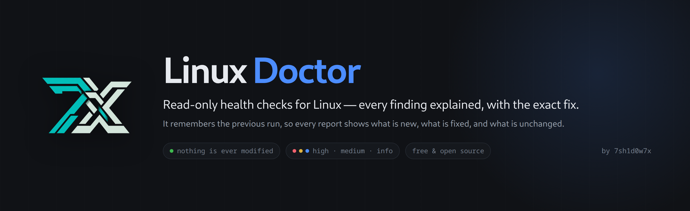
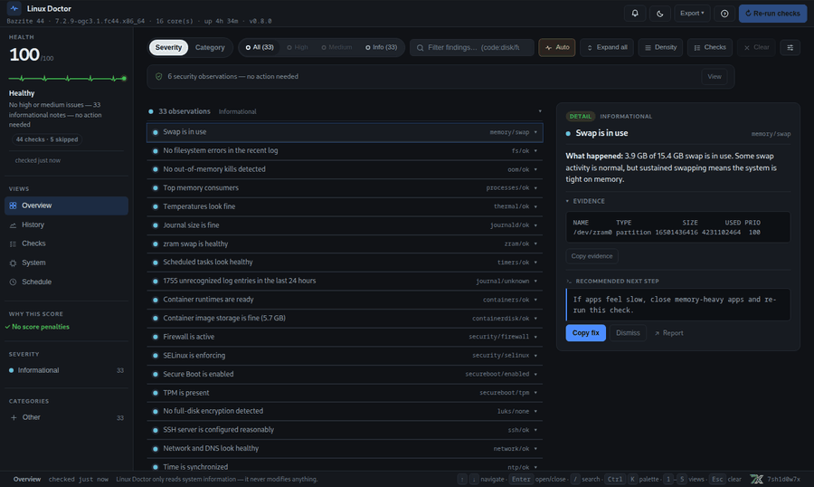

# 🩺 Linux Doctor

[](https://github.com/7sh1d0w7x/linux-doctor/releases/latest)
[](https://github.com/7sh1d0w7x/linux-doctor/actions/workflows/ci.yml)
[](https://github.com/7sh1d0w7x/linux-doctor/blob/main/LICENSE)
[](https://github.com/sponsors/7sh1d0w7x)
[](https://dev.to/7sh1d0w7x/linux-doctor-heal-thyself-20-ways-my-linux-health-checker-was-wrong-1b2a)

<p align="center">
  
</p>

**Linux diagnostics that explain the problem and remember what changed.**

Linux Doctor runs safe, read-only checks and surfaces only the issues that
actually matter. Each finding comes with an explanation and a copy-paste fix. It
remembers your last run, so every report tells you what's new, what got fixed,
and what stayed the same.

```bash
npx linux-doctor        # one run, nothing to install
```

> **What it does, and what it writes.** Four things are worth keeping apart:
>
> - **Diagnostics read.** The checks inspect the system and change nothing.
> - **It writes its own data**: run history and a small cache, under the standard
>   XDG directories (config, data, cache).
> - **Commands the checks invoke can leave their own caches.** `glxinfo` writes
>   Mesa's shader cache, `podman` initialises container storage, `dnf`/`apt` keep
>   their logs. Those are other tools' files, not changes to your configuration —
>   but "the checks write nothing at all" would be too strong a claim.
> - **Changes to the system** happen only through `--fix --yes`, which runs the
>   `[apply]` commands from the built-in catalog that you explicitly opted into.
>   `[manual]` items are never executed for you.
>
> Drop-in checks (`~/.config/linux-doctor/checks/`) and the Pro add-on are code
> that **you** install and run with your own privileges. See
> [docs/configuration.md](docs/configuration.md#plugins-custom-checks).

- One clear next step. Every report leads with START HERE, the single most useful
  action, not a wall of graphs.
- Memory built in. A health score (0-100), a trend sparkline, and a plain
  NEW/FIXED diff on every run.
- Read-only by default: the checks never modify your system. What they write is
  their own history and cache, plus whatever caches the commands they call keep
  (see above). `--fix` prints a dry-run plan; `--fix --yes`
  runs only the `[apply]` commands from the pinned safe-fix catalog, and `[manual]`
  items are never executed for you.
- CLI, web dashboard and desktop app (Tauri) run the exact same checks.
- Runs from `npx`, npm, an RPM, a `.deb` or the AppImage, and works on immutable
  distros (Silverblue, Bazzite).

<p align="center">
  
</p>

<p align="center">
  
</p>

## Why Linux Doctor?

Linux already has the data. `journalctl`, `systemctl --failed`, `df`, `free`,
`smartctl`. What it does not give you is the answer: you get raw output and you
have to find the line that matters. Linux Doctor reads the same sources and
returns the **conclusion**: what is wrong, why it matters, and the command to
fix it.

It is deliberately **a doctor, not a monitor**. It does not stream metrics,
manage processes, or sit in the background waiting to page you. It answers
"what's wrong right now?" in seconds, remembers the previous answer, and tells
you what changed. That is a different job from a monitoring stack:

| Tool | Job |
|---|---|
| Uptime Kuma, Beszel, Netdata | always-on metrics, uptime, alerting |
| Cockpit | interactive server administration |
| `inxi` / `neofetch` | hardware and system *inventory* |
| `systemd-analyze`, `top` | one narrow view each (boot time, live processes) |
| **Linux Doctor** | **diagnose → explain → suggest a fix → remember what changed** |

Run it when something feels off, before filing a bug report, or daily from a
`systemd` timer. You get one clear next step instead of a wall of graphs. Use it
alongside your monitoring stack, not instead of it.

## Download the app (recommended)

Desktop app (no install, no package manager):

- **[Latest release](https://github.com/7sh1d0w7x/linux-doctor/releases/latest)** — grab `linux-doctor-<version>-x86_64.AppImage`

```bash
chmod +x linux-doctor-*-x86_64.AppImage
./linux-doctor-*-x86_64.AppImage
```

Also attached to each release: `.deb` (Debian/Ubuntu), `.rpm`
(Fedora/RHEL/openSUSE) and the CLI tarball.
AppImage runs on most distributions (glibc-based); on immutable systems
(Fedora Silverblue, Bazzite) it works out of the box. **Nothing needs to be
installed**: the desktop packages embed their own Node.js 22 runtime
(`<resources>/runtime/node`), so the app's checks run even on a machine with
no Node on `PATH`. `LINUX_DOCTOR_NODE=/path/to/node` still overrides it.

> Installed size: the bundled runtime adds roughly 130 MB to the package.

### Verify your download

The AppImage, the `.deb` and the `.rpm` each carry a minisign signature (`.sig`),
and every release ships `SHA256SUMS-bundles.txt`. The signature is checked
against the public key embedded in the app
(`src-tauri/tauri.conf.json` → `plugins.updater.pubkey`), so a tampered file fails
exactly the check the updater would run:

```bash
git clone --depth 1 https://github.com/7sh1d0w7x/linux-doctor && cd linux-doctor
PUB=$(node -e 'console.log(require("./src-tauri/tauri.conf.json").plugins.updater.pubkey)')
node scripts/verify-updater-signature.mjs "$PUB" \
  ~/Downloads/linux-doctor-X.Y.Z-x86_64.AppImage.sig \
  ~/Downloads/linux-doctor-X.Y.Z-x86_64.AppImage
# signature OK: … (ED, sha256 …)
```

For a plain integrity check without a checkout, `sha256sum` the file you
downloaded and compare it with the matching line in `SHA256SUMS-bundles.txt`
(the paths there are relative to the release build's `dist/`, so compare on the
file name). A checksum catches a broken download; only the signature catches a
swapped one.

<details>
<summary>Troubleshooting: blank window or EGL errors (AppImage)</summary>

The AppImage bundles the WebKitGTK of the machine that built it, so the webview
is tied to the driver stack it was compiled against. Two different situations:

**v0.8.2 and later** — built on Fedora 44 (WebKitGTK 2.54.1), which renders on
current Mesa. Nothing needs to be set. Two defaults are applied before any
GTK/WebKit code runs, and each can be opted out of:

- the AppImage defaults to software GL (a diagnostics dashboard does not need the
  GPU), so `LINUX_DOCTOR_HARDWARE_GL=1` forces hardware rendering;
- WebKit's DMA-BUF renderer is disabled (the usual cause of a white window), so
  `WEBKIT_DISABLE_DMABUF_RENDERER=0` opts back in.

**v0.8.0 and v0.8.1** — built on Ubuntu 22.04 (WebKitGTK 2.44). On a host with
very new Mesa the web process aborts with
`Could not create default EGL display: EGL_BAD_PARAMETER` and the window stays
empty. On the machine where this was measured, `WEBKIT_DISABLE_DMABUF_RENDERER=1`,
`LIBGL_ALWAYS_SOFTWARE=1`, `WEBKIT_DISABLE_COMPOSITING_MODE=1`, `EGL_PLATFORM=x11`
/ `wayland` / `surfaceless`, `GDK_BACKEND=wayland`, `DRI_PRIME=0/1` and eleven
combinations of them changed nothing. What does work:

- upgrade to v0.8.2 or later, or
- install the `.deb`/`.rpm`, or the [OBS package](#install--first-run-cli): those
  use the WebKitGTK shipped by your distribution, which matches your host.

This is about the host's driver stack, not the GPU brand: **AMD, Intel and
nouveau** all run on Mesa and are equally exposed; NVIDIA's proprietary driver
ships its own stack.
</details>

## Install & first run (CLI)

Needs Node.js ≥ 20.

```bash
npx linux-doctor                      # one run, nothing installed
npm install -g linux-doctor           # or install it, then run `linux-doctor`
```

Want the current `main` instead of the latest release?
`npx github:7sh1d0w7x/linux-doctor`.

Prefer a native package?

- **CLI, Arch:** build the [PKGBUILD](packaging/aur/PKGBUILD) with `makepkg -si`. It is not in the AUR yet (registration there is closed at the moment), so the PKGBUILD in this repository is the only Arch path for now.
- **CLI, Fedora:** the [OBS repository](https://build.opensuse.org/project/show/home:7sh1d0w7x:linux-doctor) currently publishes Fedora 42 (`sudo dnf install linux-doctor`), or build with the [linux-doctor.spec](packaging/linux-doctor.spec). RHEL and openSUSE targets are not published there yet.
- **Desktop app:** the `.deb`, `.rpm` and AppImage attached to each [release](https://github.com/7sh1d0w7x/linux-doctor/releases/latest) are the GUI, not the CLI. On Debian/Ubuntu that `.deb` is what you want for the app; for the CLI there, `npx linux-doctor` (or the source tarball) is the path until an apt repository exists.
- **Immutable systems** (Silverblue, Bazzite): use `npx` or the AppImage rather than layering a package.

```
STATUS   0 high, 2 medium, 19 info · health 74/100
TREND    ▄▅▅▆▆▇  last 6 run(s) · 61 → 74 ▲

▶ START HERE   #1 System is low on usable memory
               Close apps you are not using, then re-run this check.

Your system is low on usable memory: 9.4 GB of 15 GB is in use and 2.2 GB is
being pushed to swap. This is the most common cause of a sluggish desktop.
How to fix: close unused browser tabs, then re-run this check.

Since last run: 2 new · 1 fixed · 19 unchanged
```

The report leads with a **▶ START HERE** line (the single most useful
action) and a **TREND** sparkline, and every run is diffed against the
previous one. Read-only by default: `--fix` prints a dry-run plan of
commands sourced only from a small built-in safe-fix catalog, and running it
needs a second opt-in (`--fix --yes`), and `[manual]` items always stay
yours to run.

## Which distributions?

Two different claims, kept apart: the **checks** are tested in CI on clean
images, and the **desktop app** is verified only where it has actually been
launched.

| Distribution | CLI checks | Desktop app | How it was verified |
|---|---|---|---|
| Fedora 42 / Bazzite | yes | AppImage, `.rpm`, OBS repo | CI container (checks); CLI and AppImage run by hand on Bazzite 44. The OBS repository publishes Fedora 42 only |
| Debian / Ubuntu | yes | `.deb` | CI containers (Debian, Ubuntu); the `.deb` was built and its dependencies inspected |
| Arch | yes | AppImage | CI container (checks only); the PKGBUILD is not published yet |
| Alpine | yes | — | CI container (checks only) |

"CI container" means the engine ran there and produced no unexpected high or
medium finding on a clean image — a real test against false positives, and
nothing more than that. It does **not** prove the desktop app renders on that
distribution: the GUI is a Tauri/WebKit bundle and is only verified where it was
actually started. If you run it somewhere not listed here, the report is still
useful — that is what the [support bundle](#community) is for.

## What it checks

Every finding carries a stable identity: a `code` (`check/reason`), a
severity decided against the [severity rubric](docs/severity.md), human
detail, evidence from the system, and a suggested fix. Codes are the join
key for history diffing (NEW/FIXED) and for `--ignore-code`, so they never
change silently.

| ID | What it checks |
|---|---|
| `memory` | RAM pressure, swap usage |
| `load` | CPU load vs core count |
| `disk` | Real partitions near full (ignores virtual/immutable roots) |
| `inodes` | Inode usage: "No space left" with free space showing in `df -h` |
| `fs` | Filesystem errors (btrfs, read-only remounts) |
| `raid` | Software RAID health (mdadm/ZFS) — degraded arrays, resync in progress |
| `oom` | Out-of-memory kills |
| `zram` | Swap/zram health — compressed swap near full, swappiness |
| `locales` | System locale — missing/broken locale generation |
| `services` | Failed systemd services (system + user); services stuck in a restart loop |
| `certs` | TLS certificate expiry (certbot state + actually-deployed certs on local TLS ports) |
| `ports` | Risky services (databases, FTP/Telnet) listening outside localhost without a firewall |
| `fds` | File-descriptor pressure (`/proc/sys/fs/file-nr` near the kernel limit) |
| `timers` | Scheduled tasks — enabled systemd timers that never run |
| `journal` | Error log, with known-benign noise filtered out |
| `journald` | System journal (log) disk usage |
| `suspend` | Failed suspend/resume hooks (laptops) |
| `containers` | Container runtimes — podman/docker installed and usable; dead, OOM-killed (exit 137), or restart-looping containers |
| `containerdisk` | Container image storage (podman/docker) — hidden disk usage |
| `crash` | Crash and reboot history (coredumps + unexpected restarts, correlated with automatic-update mechanisms) |
| `security` | Firewall, SELinux, update services |
| `ssh` | SSH server posture — root login, password authentication |
| `autologin` | Automatic login enabled in the display manager |
| `secureboot` | UEFI boot mode, Secure Boot state, TPM presence |
| `network` | Default route and DNS resolution |
| `ntp` | Clock synchronization (time sync daemon state) |
| `wifi` | WiFi — rfkill blocked, NetworkManager disabled, adapter presence |
| `updates` | Pending package updates (dnf/apt/pacman) |
| `snap` | Pending snap refreshes and the snapd auto-refresh timer |
| `firmware` | Pending firmware (BIOS/UEFI) updates via fwupd |
| `flatpak` | Pending Flatpak app updates + unused runtimes (`flatpak uninstall --unused`) |
| `reboot` | Newer kernel installed but not booted, pending restart |
| `processes` | Top memory consumers, with friendly names |
| `thermal` | CPU temperatures and thermal-throttling events |
| `battery` | Laptop battery level and capacity wear (skipped on desktops) |
| `gpu` | Graphics driver health (NVIDIA proprietary vs nouveau vs missing, software rendering) |
| `gpu-usage` | GPU VRAM pressure (NVIDIA/AMD) — nearly-full VRAM flagged (AI/ML OOM risk) |
| `bluetooth` | Bluetooth controller presence and daemon state |
| `wayland` | Display session type, running compositor, software rendering |
| `audio` | Sound server (PipeWire/PulseAudio) and output device (desktop/laptop) |
| `backup` | Backup/snapshot tools installed, scheduled, and actually running (stale backups flagged) |
| `fstrim` | SSD TRIM — weekly fstrim.timer enabled or continuous discard mounting |
| `hardware` | Machine check exceptions and corrected ECC memory errors |
| `smart` | Disk SMART health (needs root or smartmontools) |
| `luks` | Full-disk encryption (LUKS) presence |
| `boot` | Boot partition space and bootloader config (`/boot` full, missing `grub.cfg`) |
| `cache` | User cache and trash bloat (`~/.cache`, `~/.local/share/Trash`) |
| `packages` | Package manager health — broken/locked apt/dnf/pacman database |
| `orphans` | Orphaned packages (`pacman -Qtd`, `apt autoremove`, `dnf autoremove`) |

Checks that don't apply to your machine, like `battery` on a desktop or
`reboot` on immutable systems, are skipped automatically and reported honestly in a
**Skipped** section instead of producing misleading findings.

## Health score & history

Every run is saved to `~/.local/share/linux-doctor/history.json` (override
with `LINUX_DOCTOR_HISTORY`). From that history you get a **health score
(0–100)** with an auditable breakdown (`100 − Σpenalties`), a **TREND**
sparkline of your last runs, and a plain-language **diff per run**: new,
fixed, unchanged. Findings that share a root cause are collapsed before
scoring, so one problem never counts twice. History is a bonus, never a
dependency: `--no-history` disables it, and if it cannot be written the
report still works.

## Documentation

| Doc | Contents |
|---|---|
| [docs/cli.md](docs/cli.md) | every flag, `--fix`, `--interactive`, `--notify`, `--plain`, exit codes, shell completions, systemd timer |
| [docs/dashboard.md](docs/dashboard.md) | the `--web` dashboard and the desktop app, in detail |
| [docs/configuration.md](docs/configuration.md) | ignore list, thresholds, plugins, caching, immutable-distro behavior |
| [docs/integrations.md](docs/integrations.md) | JSON schema v1, `--support` bundles, optional AI summary, fleet reporting |
| [docs/severity.md](docs/severity.md) | how severities are decided |
| [docs/doctrine.md](docs/doctrine.md) | what the tool refuses to do, and how a finding earns trust |
| [docs/limitations.md](docs/limitations.md) | what it does not detect, and the false positives we have fixed |
| [docs/compatibility.md](docs/compatibility.md) | the public surface, and how changes are announced |
| [docs/case-studies/](docs/case-studies/inode-exhaustion.md) | reading a report in a concrete case — inode exhaustion (lab, not an incident) |
| [docs/licensing.md](docs/licensing.md) | what the GPL grants and requires |
| [docs/trademark.md](docs/trademark.md) | the name/logo vs. the code license |
| [CHANGELOG.md](CHANGELOG.md) | every release, Keep-a-Changelog style |

## Community

Questions, ideas and show-your-setup go to
[GitHub Discussions](https://github.com/7sh1d0w7x/linux-doctor/discussions);
bugs and check requests to [Issues](https://github.com/7sh1d0w7x/linux-doctor/issues).
Contributions are welcome, see [CONTRIBUTING.md](CONTRIBUTING.md).

**Think a finding is wrong?** That is the most useful report you can send. Run
`linux-doctor --support`: it writes `linux-doctor-support-<timestamp>.json` in the
current directory and prints the path. The bundle carries your distro, the
findings, their evidence and a short history — with IP addresses and
`/home/<user>` paths redacted, and the hostname and username left out entirely.
What was removed is listed under `privacy.excluded`, and the full shape is in
[docs/integrations.md](docs/integrations.md).

Read it before you attach it, anyway. Open the JSON, look at
`findings[].evidence` — that is where command output and paths live — and delete
or edit anything you would rather not publish. Then attach it to the issue and
say what you expected instead: "this says the disk is full, but `df -h` shows 40%
free" is a report we can act on; "it's wrong" is not.

## Roadmap

- ~~GUI with a one-click report~~: shipped as a Tauri desktop app
- ~~Report history and change detection~~: shipped (health score, NEW/FIXED diff)
- ~~More checks (Bluetooth, Wayland, backup, hardware errors, LUKS)~~: shipped
- Auto-generated, distro-specific fix instructions
- The AUR package, once registration there reopens (the PKGBUILD is ready); AppStream metadata already ships in every package (Flatpak is not a fit; see [packaging/README.md](packaging/README.md))
- Maintenance: single maintainer, AI-assisted. Roadmap lives in the CHANGELOG and
  in GitHub issues. Security fixes within days, contributions welcome.

## Transparency and evidence

Development is AI-assisted, and every decision is the author's. Don't take the
README's word for it; the artifacts are public:

- [the test suite](tests/): golden snapshots for every output format,
  shell-safety tests for the fix catalog, and output-parity tests that keep the
  CLI and the dashboard in agreement.
- [CI](https://github.com/7sh1d0w7x/linux-doctor/actions/workflows/ci.yml) runs
  the whole report on Fedora and on Node 20, 22 and 24, plus the Rust app on
  `fmt`, `clippy` and `cargo audit`.
- A clean-image gate runs the engine inside Fedora, Debian, Ubuntu, Alpine and
  Arch containers and fails when a high or medium finding appears that the baseline
  does not justify. Recorded machine fixtures (real command outputs, scrubbed)
  replay the same way, and every finding they produce needs a written reason.
- Read-only diagnostics by construction, with a pinned safe-fix catalog. The egress paths
  scrub findings and refuse private endpoints by default, and
  [docs/doctrine.md](docs/doctrine.md) lists what the tool refuses to do, each
  claim tied to the test that enforces it.
- Every change is in the [CHANGELOG](CHANGELOG.md); releases are signed tags.

<a id="tiers"></a>
## Editions

This repository **is** the Free edition: the whole product for everyday
users, GPL-3.0-or-later, forever. Optional paid tiers for power users and
companies are strictly additive and described in
[COMMERCIAL-LICENSE.md](COMMERCIAL-LICENSE.md).

## Licensing & brand

**Dual-licensed.**

- [GPL-3.0-or-later](LICENSE) — free for individuals and open-source projects. You may copy, modify and redistribute it, but any derivative work you distribute must stay open-source under the same terms.
- [Commercial license](COMMERCIAL-LICENSE.md) — for companies that need to use Linux Doctor inside proprietary products.

Details on what the GPL grants and requires: [docs/licensing.md](docs/licensing.md).

What that means in practice:

- **Copying the Free edition is allowed** — that is the point of the GPL. Forks are welcome as long as they keep the license and the notices.
- **It is still not a free-for-all**: a distributed derivative must stay GPL, and shipping the code inside a closed product requires the commercial license. That obligation is enforceable copyright, not a polite request.
- **The paid tiers' code is not here.** Pro/Business/Enterprise live in private repositories; this edition is, and stays, the whole product for everyday users.
- **The name and logo are not covered by the code license.** If you fork, ship it under your own name — see [docs/trademark.md](docs/trademark.md).

Every source file carries an `SPDX-License-Identifier: GPL-3.0-or-later` header. By contributing, you agree your contributions are offered under both licenses (see [CONTRIBUTING.md](CONTRIBUTING.md)).
